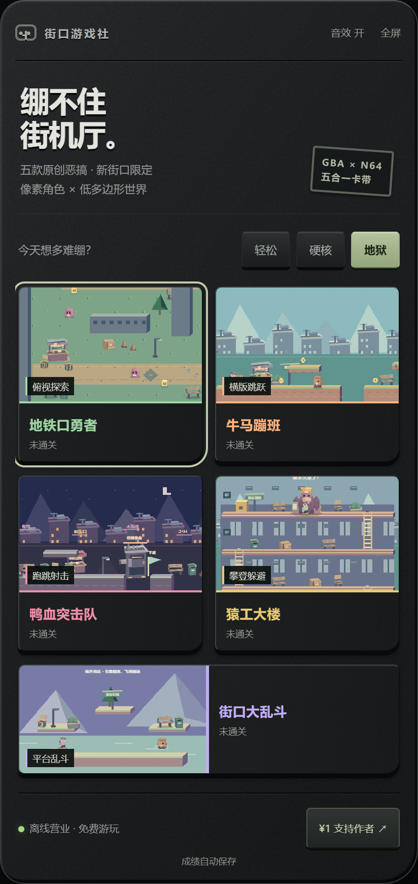

# 绷不住街机厅

五款原创恶搞游戏，黑色磨砂掌机界面与低多边形场景。默认地狱难度。

[在线试玩](https://Vmegaaa.github.io/xinjiekou-pocket-arcade/) · [隐私说明](https://Vmegaaa.github.io/xinjiekou-pocket-arcade/privacy.html)

| 游戏 | 玩法 | 需要留意 |
| --- | --- | --- |
| 地铁口勇者 | 探索、近战、翻滚、收集地铁卡 | 拟态卡、伏击、符文、两阶段闸机 Boss |
| 牛马蹦班 | 冲刺、跳跃、踩怪、收集工钱 | 坍塌平台、突刺、假出口 |
| 鸭血突击队 | 跑跳、连续射击、打堡垒 | 过热、护盾兵、地雷、回头弹 |
| 猿工大楼 | 爬梯、跳跃、砸桶、拿工资 | 电梯子预警、滚动需求桶 |
| 街口大乱斗 | 二段跳、出拳、闪避、击出场外 | 弹反、伤害击退、漏电边缘 |

三档难度；本地保存成绩。角色、场景、几何模型和音效均为本项目制作，未使用所参考作品的角色、标志、贴图、音乐或关卡素材。

## 操作

| 功能 | 键盘 | Xbox / 标准手柄 | PlayStation |
| --- | --- | --- | --- |
| 移动 / 选卡 | WASD / 方向键 | 左摇杆 / 十字键 | 左摇杆 / 十字键 |
| 主动作 / 确认 | Z / 空格 | A | × |
| 副动作 | X / Shift | X / RB | □ / R1 |
| 暂停 | P / Esc | Start / Menu | Options |
| 返回 | Esc | B | ○ |
| 重试 | R | 失败后 A | 失败后 × |

触屏可同时按方向键和动作键。翻滚、出拳等动作消耗体力；射击时显示枪温。
浏览器手柄操作需通过 HTTPS 或 localhost，首次按键后连接；物理手柄型号仍需各设备实测。

## 本地运行与修改

直接打开 `index.html` 即可游玩，不依赖外部脚本、贴图服务或游戏引擎。
修改 `src/` 后运行 `python build.py` 重建单文件页面。
`assets/` 为作者提供的个人微信、支付宝收款码，入口为自愿 ¥1 支持，金额在支付应用内手动确认。游戏不检测支付、不自动解锁、不显示虚构营收。

## UE 5.8.1 手机集成

当前已在本地新街口工程的手机中接入“五合一卡带”，不是将网页改名为 UE 项目。
`ue/Plugins/XJKArcadeInput` 提供独立原生手柄桥接源代码；Win64 模块已通过 UE 5.8.1 定向编译。
宿主页面通过 `cityArcadeHost.active/back/pad/input` 控制生命周期与操作；离开手机时暂停并释放按键。
完整新街口工程、原手机页面和私人内容没有上传到此仓库。
UE 编辑器内运行与真实手柄尚需设备验收；本次网页截图及视频是浏览器中的实际运行画面。

## 发布状态

此仓库为网页试玩。TapTap 版本尚未上架；上架素材单独准备，安卓签名安装包、开发者身份、正式应用资料和审核尚待完成。
MotionBrick 未接入：尚未确认用户所指 NVIDIA 工具的准确产品与接口。
